# Header Ahead

Ein kooperatives Lern-Tabletop zu den Schichtenmodellen ISO/OSI und TCP/IP.
Die Spielteile kommen aus dem 3D-Drucker, Karten und Anleitung aus dem normalen Drucker.

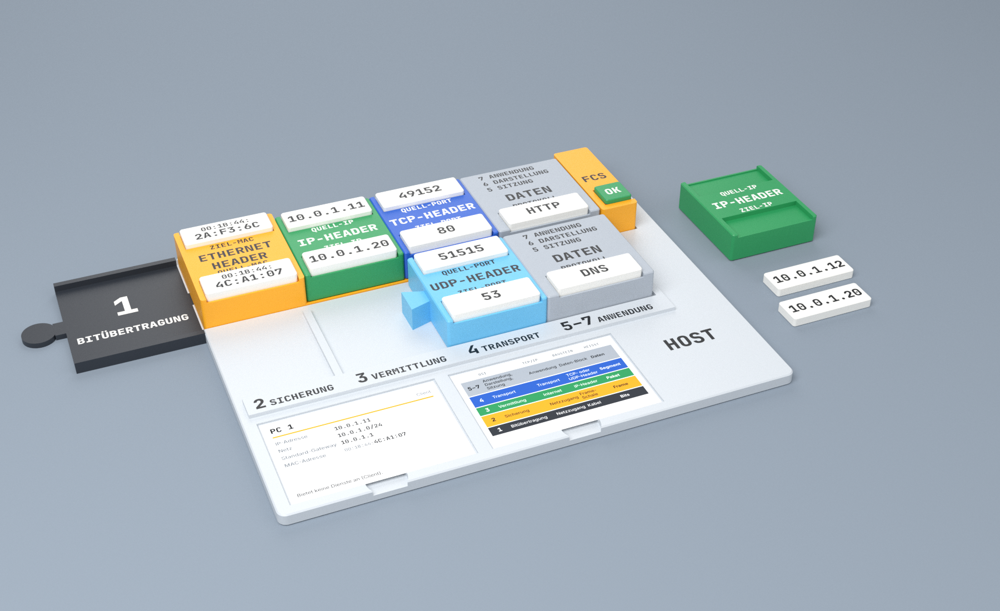

| | |
|---|---|
| **Spielende** | 2 bis 6, alle spielen gemeinsam gegen die Uhr |
| **Dauer** | 30 Minuten mit Aufbau |
| **Zielgruppe** | ITS, 10. Klasse (Fachinformatiker) |
| **Thema** | Kapselung, Adressen je Schicht, Switch und Router |
| **Material** | 18 verschiedene Druckteile, Karten und Anleitung als PDF |

**Direkt zu:** [Spielanleitung (PDF)](Spielanleitung.pdf) · [Karten (PDF)](Karten.pdf) · [Druckdateien](druck/stl) · [Druckliste](#drucken)

## Worum es geht

Die Gruppe ist gemeinsam das Netz. Ein Auftrag kommt herein, zum Beispiel: PC 1 ruft eine Webseite auf.
Der Absender kapselt die Daten Schicht für Schicht, Switch und Router reichen sie weiter, der Empfänger
entkapselt sie wieder. Jede Station liest nur, was ihre Schicht angeht. Passt etwas nicht, bleibt die
Dateneinheit hängen, genau wie im echten Netz.

Danach können die Lernenden

- die Schichten beider Modelle nennen und einander zuordnen,
- erklären, wie aus Daten ein Segment, ein Paket und ein Frame wird,
- sagen, welche Adresse zu welcher Schicht gehört: Port, IP, MAC,
- begründen, warum sich am Router die MAC-Adressen ändern und die IP-Adressen nicht.

## So funktioniert es

### Der Header kommt vorn dran

Die Dateneinheit besteht aus Bausteinen, die hintereinander gesteckt werden: Daten, davor der TCP- oder
UDP-Header, davor der IP-Header. Die Zapfen passen nur in der richtigen Reihenfolge. Jeder Baustein hat
Fächer für die Adressen seiner Schicht; die Adressen sind Plättchen zum Einstecken.

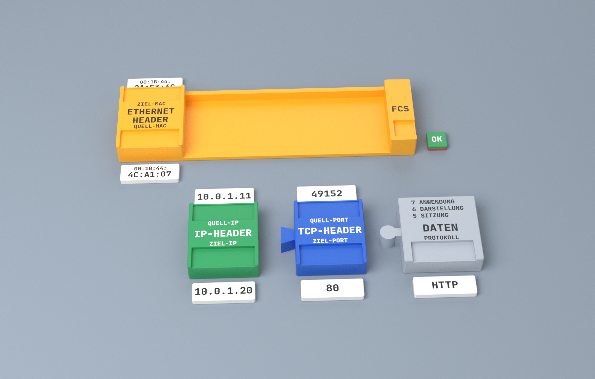

Der Frame ist eine Schale mit dem Ethernet-Header als Vorderwand und der Prüfsumme (FCS) als Rückwand.
Das Paket liegt darin.

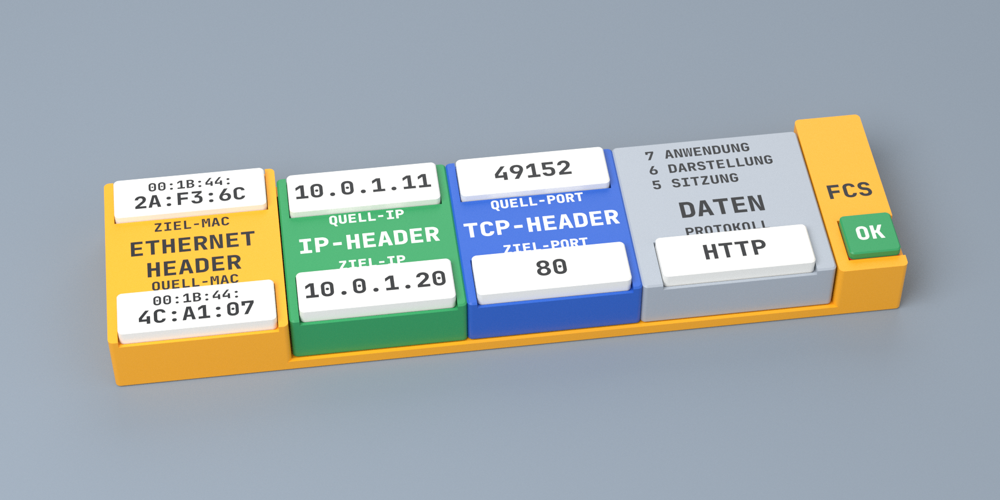

### Kapseln in fünf Schritten

| 5–7 Anwendung | 4 Transport | 3 Vermittlung | 2 Sicherung | 1 Bitübertragung |
|---|---|---|---|---|
| 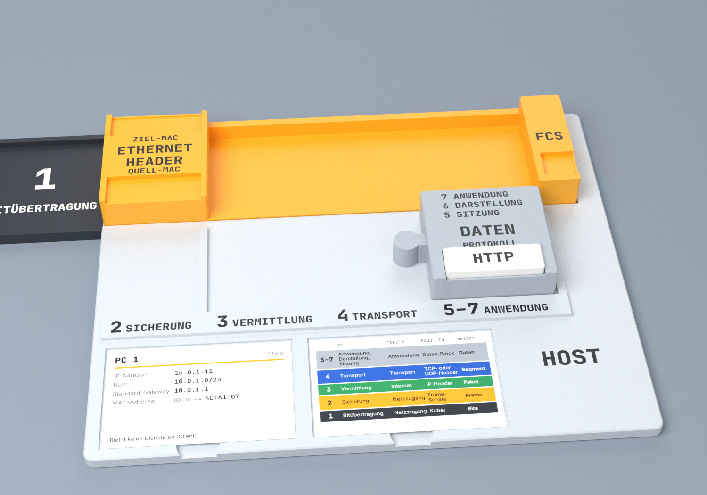 | 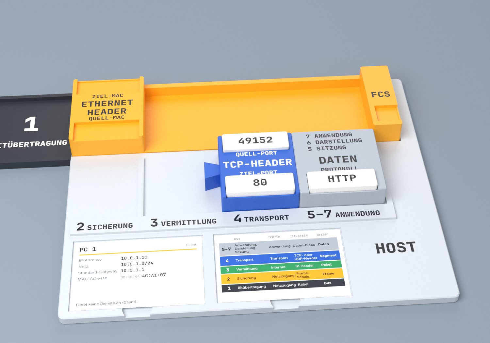 | 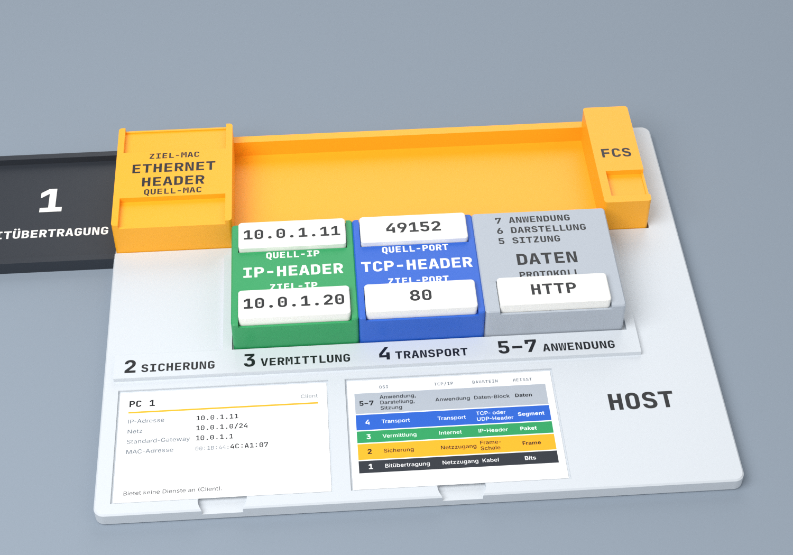 | 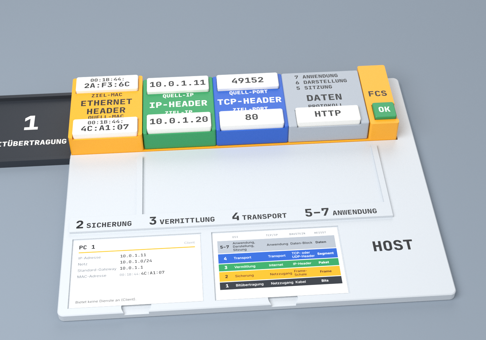 | 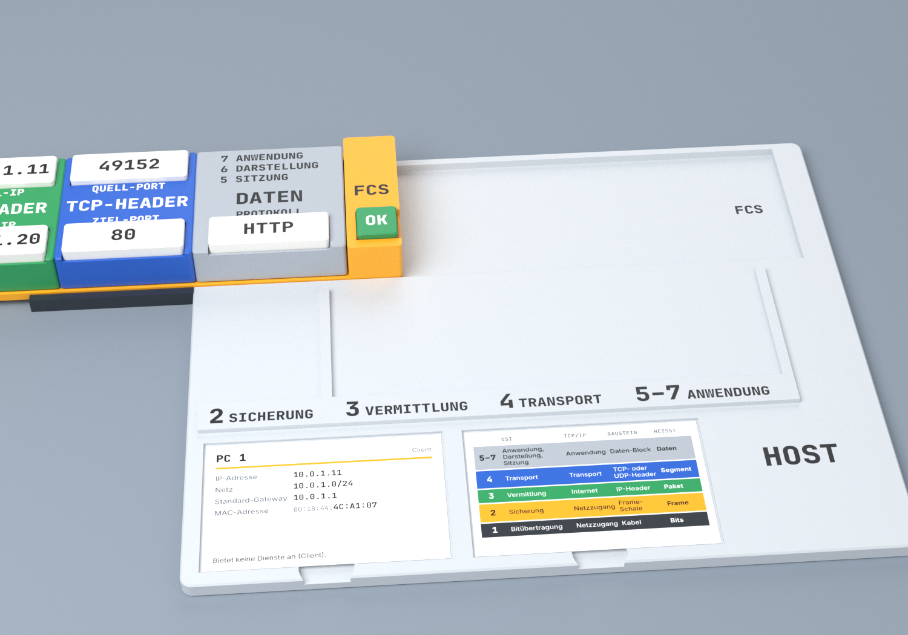 |
| Daten-Block mit dem Protokoll | TCP- oder UDP-Header mit den Ports: ein Segment | IP-Header mit den IP-Adressen: ein Paket | In die Schale mit den MAC-Adressen und der FCS: ein Frame | Über das Kabel zur nächsten Station |

### Switch und Router lesen nur ihre Schichten

| Switch | Router |
|---|---|
| 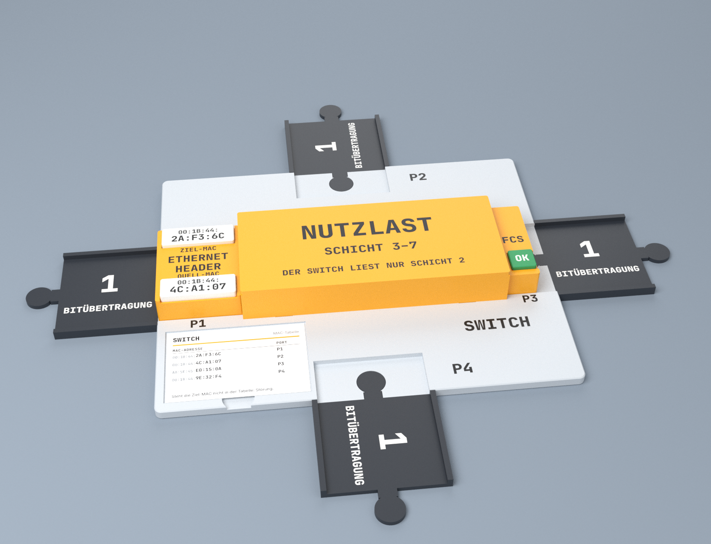 | 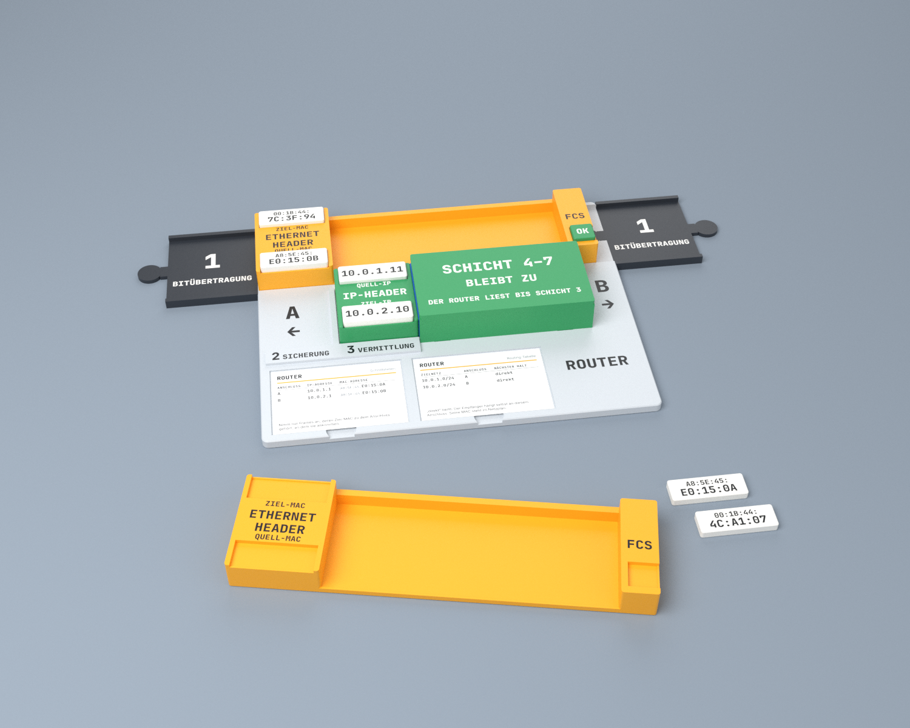 |
| Der Tunnel verdeckt alles außer Ethernet-Header und FCS. Der Switch sucht die Ziel-MAC in seiner Tabelle und schiebt die Schale am passenden Port weiter. | Das Paket wird aus der Schale geschoben, TCP-Header und Daten verschwinden unter dem Dach. Der Router liest die Ziel-IP und legt das Paket in eine neue Schale: Die MAC-Adressen wechseln, die IP-Adressen bleiben. |

### Das Spielbrett

Das Brett ist modular: Stationsplatten, verbunden durch Kabel. Die Schale wird von Platte zu Platte geschoben.

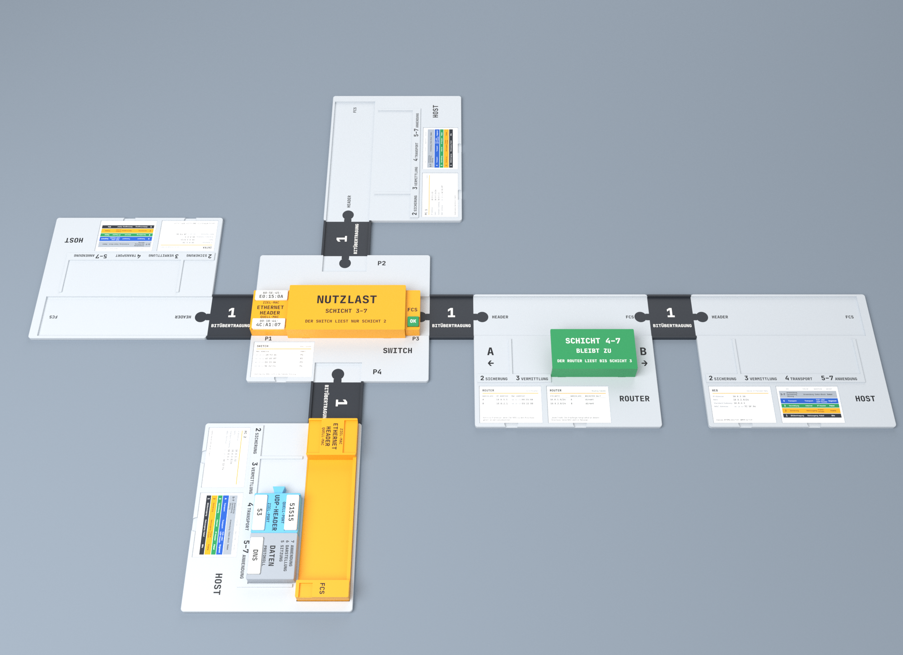

| Stufe | Aufbau | Darum geht es |
|---|---|---|
| **1 · Ein Netz** | PC 1, PC 2, INTRA, Switch | Kapseln und Entkapseln, Segment, Paket, Frame, TCP oder UDP, MAC-Tabelle |
| **2 · Über den Router** | zusätzlich Router und WEB | Eigenes oder fremdes Netz, Standard-Gateway, neuer Frame am Router |
| **3 · Störfälle** | wie Stufe 2, dazu Ereigniskarten | Bitfehler und FCS, TCP wiederholt, UDP nicht, zwei Dateneinheiten gleichzeitig |

Die vollständigen Regeln, Hinweise für Lehrkräfte und Fragen für die Auswertung stehen in der
[Spielanleitung](Spielanleitung.pdf).

## Drucken

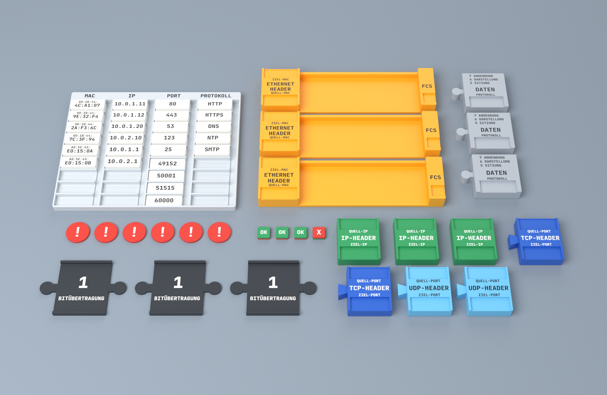

- Die Dateien in [`druck/stl`](druck/stl) liegen in Drucklage. Kein Teil ist größer als 240 × 200 mm.
- Zu jedem Teil gibt es zwei Dateien: `<teil>.stl` ist der Körper mit 0,6 mm vertiefter Schrift,
  `<teil>_schrift.stl` füllt die Vertiefung in einer zweiten Farbe. Einfarbig gedruckt bleibt die Schrift vertieft.
- [`druck/step`](druck/step) enthält dieselben Teile als STEP für die Weiterarbeit im CAD.
- Die Luft an den Steckverbindungen beträgt 0,2 mm je Seite (`SPIEL` in `cad/masse.py`).

| Teil | Anzahl | Farbe / Schrift | Maße in mm | Datei | Hinweis |
|---|---|---|---|---|---|
| Frame-Schale | 3 | Orange / Schwarz | 227 × 62 × 19 | `frame_schale` | |
| IP-Header | 3 | Grün / Weiß | 50 × 56 × 16 | `ip_header` | |
| TCP-Header | 2 | Blau / Weiß | 60 × 56 × 16 | `tcp_header` | |
| UDP-Header | 2 | Hellblau / Schwarz | 60 × 56 × 16 | `udp_header` | |
| Daten-Block | 3 | Silber / Schwarz | 71 × 56 × 16 | `daten_block` | |
| FCS-Plättchen | 4 | Grün / Weiß | 15 × 15 × 5 | `fcs_plaettchen` | Farbwechsel bei 2,5 mm: unten rot, oben grün |
| Störungs-Chip | 6 | Rot / Weiß | 28 × 28 × 3 | `stoerungs_chip` | |
| Kabel | 6 | Anthrazit / Weiß | 100 × 68 × 6 | `kabel` | 5 im Spiel, 1 Reserve |
| Host-Platte | 4 | Hellgrau / Schwarz | 240 × 200 × 8 | `platte_host` | |
| Switch-Platte | 1 | Hellgrau / Schwarz | 240 × 200 × 6 | `platte_switch` | |
| Router-Platte | 1 | Hellgrau / Schwarz | 240 × 200 × 8 | `platte_router` | |
| Switch-Tunnel | 1 | Orange / Schwarz | 158 × 70 × 27 | `switch_tunnel` | liegt in der STL-Datei kopfüber |
| Router-Dach | 1 | Grün / Weiß | 110 × 60 × 27 | `router_dach` | liegt in der STL-Datei kopfüber |
| Vorratskasten | 1 | Hellgrau / Schwarz | 223 × 179 × 10 | `vorratskasten` | |
| Plättchen MAC | 1 Bogen | Weiß / Schwarz | 194 × 57 × 5 | `plaettchen_mac` | 12 Plättchen |
| Plättchen IP | 1 Bogen | Weiß / Schwarz | 194 × 57 × 5 | `plaettchen_ip` | 12 Plättchen |
| Plättchen Ports | 1 Bogen | Weiß / Schwarz | 194 × 78 × 5 | `plaettchen_port` | 14 Plättchen |
| Plättchen Protokolle | 1 Bogen | Weiß / Schwarz | 194 × 57 × 5 | `plaettchen_protokoll` | 10 Plättchen |

Auf Papier kommen aus [`Karten.pdf`](Karten.pdf): zwei Netzpläne, Geräte- und Tabellenkarten, Schichtenkarten,
18 Auftragskarten mit Lösung auf der Rückseite und 12 Ereigniskarten.

## Ordner

| Datei oder Ordner | Inhalt |
|---|---|
| `Spielanleitung.pdf` | Regeln, Aufbau, Hinweise für Lehrkräfte, Druckliste |
| `Karten.pdf` | Netzpläne, Geräte- und Tabellenkarten, Auftragskarten mit Lösungen, Ereigniskarten |
| `druck/stl/` | Druckdateien in Drucklage |
| `druck/step/` | Dieselben Teile als STEP |
| `druck/teileliste.json` | Anzahl, Farben, Maße |
| `bilder/` | Gerenderte Bilder |
| `cad/` | Modelle als Code (build123d), Prüfung, Render-Skript |
| `spiel/` | Spieldaten, Lösungsberechnung, Karten und Anleitung als Code |

## Selbst bauen

Alles in diesem Repository entsteht aus Code: Teile, Bilder, Karten und Anleitung.

Einrichten:

```bash
python3 -m venv .venv && .venv/bin/pip install build123d
```

Außerdem werden Blender (für die Bilder), WeasyPrint und `pdftoppm` aus poppler-utils (für die PDFs)
und die Schriften JetBrains Mono und Inter gebraucht.

Neu erzeugen, in dieser Reihenfolge:

```bash
.venv/bin/python cad/bauen.py      # STEP, STL, Teileliste (etwa 1 Minute)
.venv/bin/python cad/pruefen.py    # Größen und Passungen
python3 cad/netze_pruefen.py       # alle STL-Netze geschlossen?
python3 spiel/karten.py            # Karten.pdf und Kartenbilder
blender -b -P cad/rendern.py       # alle Bilder (einige Minuten); mit "-- --entwurf" schneller
python3 spiel/anleitung.py         # Spielanleitung.pdf
```

Einzelne Bilder: `blender -b -P cad/rendern.py -- titel switch`.

Wo man etwas ändert:

- **Maße und Passungen:** `cad/masse.py`
- **Netz, Adressen, Dienste, Aufträge:** `spiel/daten.py`. Plättchen, Karten und Lösungen folgen daraus.
- **Regeltext:** `spiel/anleitung.py`

## Stand

Prototyp. Die Passungen sind rechnerisch geprüft (`cad/pruefen.py`), aber noch nichts ist gedruckt.
Spielzeit, Punktwerte und Rangschwellen sind geschätzt, bis das Spiel im Unterricht erprobt ist.

Header Ahead ist das erste Spiel einer geplanten Reihe von Lern-Tabletops zu den eher abstrakten Themen
in ITS. Für alle Spiele der Reihe gilt: mindestens 2 Spielende, in 30 Minuten durchgespielt, ein Satz pro
Spiel, kein Druckteil größer als 240 × 200 mm.
